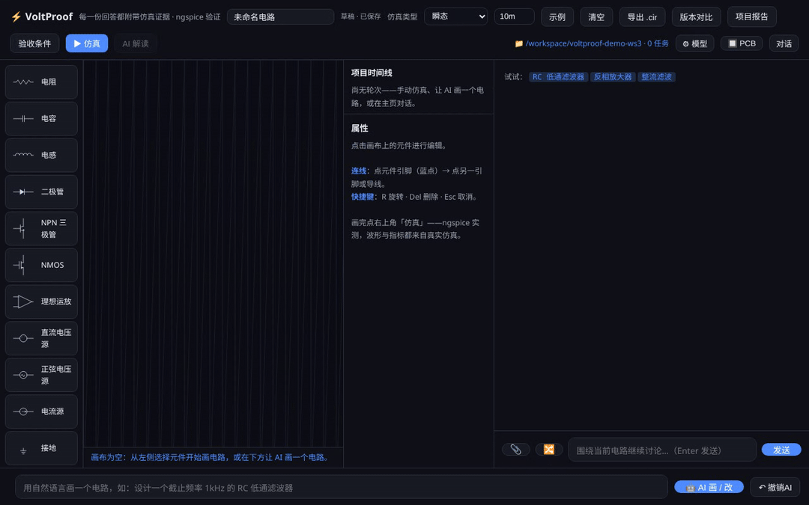
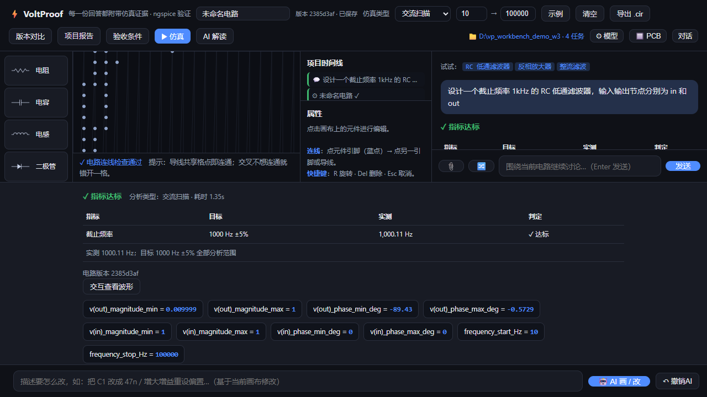
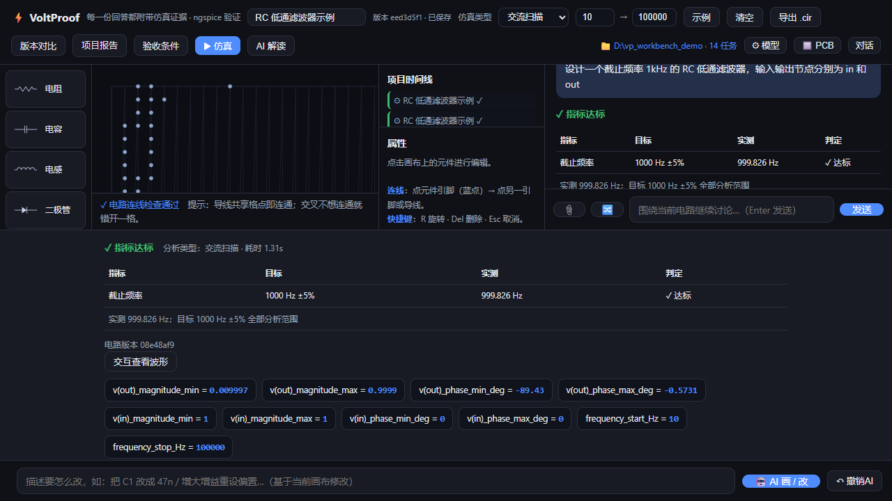
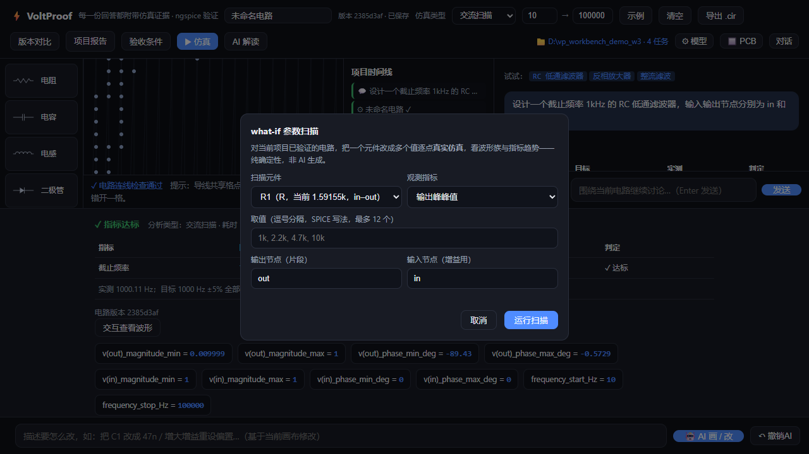
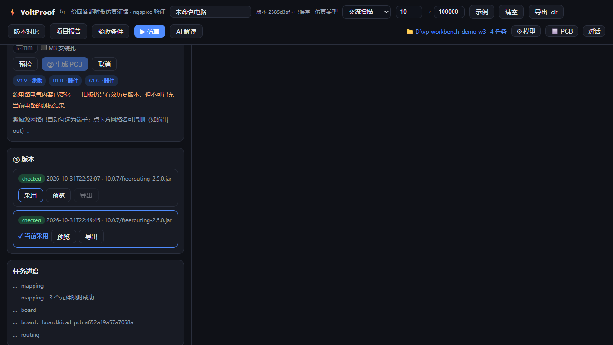

<div align="center">

# VoltProof

**AI circuit answers, verified by real ngspice simulation.**

[English](README.md) · [简体中文](README.zh-CN.md)

[](https://github.com/Kevin-Y572/VoltProof)
[](https://www.python.org/)
[](LICENSE)

Natural language in → AI writes a SPICE netlist → **ngspice actually simulates it** → waveforms, measured metrics, a schematic, and an AI explanation.



[Features](#features) · [Quick start](#quick-start) · [Benchmarks](#benchmarks) · [MCP](#mcp)

</div>

Ask an LLM directly and you get text *about* a circuit. VoltProof gives you a **simulation-verified circuit**—every number comes from ngspice. If a target is missed, the error is fed back and the model retries automatically.

## Why VoltProof

| | Asking an LLM | VoltProof |
| --- | --- | --- |
| What you get | Text about a circuit | A simulation-verified netlist |
| Where the numbers come from | The model's guess | ngspice measurements |
| If a target is missed | You debug it | An automatic repair loop |
| Evidence | Usually none | Waveforms, metrics, schematic, and the full netlist |

The same contrast is also available in the app at `/compare.html`.

## Features

- **Simulation in the loop** — Every AI answer is run in ngspice. VoltProof measures ripple, cutoff frequency, gain, oscillation frequency, and output voltage, then compares them with your targets.
- **Automatic repair** — When a static check or simulation fails, the error and the deviation are sent back to the model. Repair rounds stream live in the UI.
- **Clear acceptance** — Common targets (cutoff, gain, ripple, output voltage, and component changes) are recognized and checked. You can also set the metric, comparison, tolerance, and nodes yourself. Items that cannot be measured are marked unverified.
- **Evidence you can inspect** — Waveforms (log frequency axis for AC), numeric metrics, a schematic, and the full netlist ship with every answer.
- **Unified workbench** — Canvas on the left, chat on the right, one project circuit. Draw and simulate with **no LLM and no API key**. Or describe a circuit in natural language; VoltProof previews it until you apply or discard it.
- **Versions and candidates** — AI-drawn circuits stay as candidates until you apply them. Undo restores the netlist, canvas, analysis, and evidence.
- **What-if sweeps** — Sweep one component across several values and run a real simulation at each point. Deterministic, not AI-generated.
- **Lab report export** — One self-contained HTML report per conversation, ready to print as PDF.
- **Bring your own model** — Any OpenAI-compatible provider (DeepSeek, OpenAI, local Ollama, and others). Keys stay on your machine.
- **MCP server** — `design_circuit` and `verify_netlist` for agents such as Claude Desktop or Cursor.

<div align="center">

| Evidence card | AI repair round | What-if sweep |
|:---:|:---:|:---:|
|  |  |  |

</div>

## Quick start

Python 3.10+ and [ngspice](https://ngspice.sourceforge.io/) are required. Put ngspice on your `PATH`, or set `VOLTPROOF_NGSPICE` to the executable.

```bash
pip install -r requirements.txt
uvicorn app.main:app --reload
```

Then open [http://127.0.0.1:8000](http://127.0.0.1:8000) for the workbench (canvas left, chat right). After `pip install .` you can also run the `voltproof` command.

| Page | URL |
| --- | --- |
| Workbench | http://127.0.0.1:8000 |
| Standalone canvas (no model required) | http://127.0.0.1:8000/draw.html |
| Side-by-side demo | http://127.0.0.1:8000/compare.html |

<details>
<summary>API key, Windows / macOS notes, and offline self-check</summary>

A model key is optional for drawing and direct simulation. For AI design, set `VOLTPROOF_API_KEY` (or `DEEPSEEK_API_KEY` / `OPENAI_API_KEY`), or fill it in from the in-page ⚙ model panel (saved to local `settings.json`).

```bash
# ngspice path, only if it is not already on PATH
# Windows (setx applies to new terminals only):
setx VOLTPROOF_NGSPICE "C:\path\to\ngspice-47\Spice64\bin\ngspice.exe"
# macOS / Linux:
export VOLTPROOF_NGSPICE=/usr/bin/ngspice

# Offline self-check (no API key)
python scripts/test_isolated.py
```

CLI pipeline:

```bash
python -m app.pipeline "Design an RC low-pass filter with a 1 kHz cutoff"
```

</details>

## Usage

- **Draw a circuit** on the left pane (or `/draw.html`): place parts, wire pins, choose DC / transient / AC analysis, and click Simulate. Dangling pins and a missing ground are flagged on the canvas. You can export a `.cir` netlist.
- **Ask AI to draw or edit** in the input bar at the bottom of the canvas. The result is previewed first—apply, discard, or undo.
- **Chat with a requirement**, for example: “Design a bridge rectifier with capacitor filtering: 220 V / 50 Hz down to 12 V, ripple < 1 V.” Follow-ups continue from the last verified netlist.
- **What-if:** use the 🔀 control under the chat to sweep one component (R, C, L, or a DC source) and optionally adopt a passing point as a new version.

A project is one circuit plus multiple threads. The canvas and the verified netlist live with the project directory, so they survive a refresh or a move to another machine.

## Benchmarks

```bash
python bench/run_bench.py                     # 18 typical circuit tasks (SPICE backend)
python bench/run_bench.py --passes=3          # pass@1 / pass@3 over 3 independent runs
python bench/run_bench.py --backend=skidl     # SKiDL backend
```

The suite covers RC/LC filters, high-pass and low-pass networks, rectifier-filter circuits, inverting / non-inverting / differential / summing amps, common-emitter amplifiers, followers, clipping, regulation, relaxation oscillators, and sensor conditioning. Acceptance is metric-level (ripple, cutoff, gain, oscillation frequency, and so on).

Latest official run (DeepSeek `deepseek-flash`, 18 tasks × 3 independent runs, 2026-10-31, this pipeline):

| | Result |
| --- | --- |
| First-generation pass rate (no repair) | **61.1%** |
| Closed-loop **pass@1** | **94.4%** |
| Closed-loop **pass@3** | **100%** |
| Average time | 40.4 s / task |

`pass@1` is success of one full closed-loop task, with up to 3 internal repair rounds. Full JSON, reports, and workspaces are stored under `bench/runs/<run_id>/`.

## MCP

VoltProof ships a stdio MCP server: `design_circuit` designs and verifies; `verify_netlist` verifies a netlist as-is with no LLM by default, or repairs it when `repair=true`.

```json
{
  "mcpServers": {
    "voltproof": {
      "command": "python",
      "args": ["-m", "app.mcp_server"],
      "cwd": "<VoltProof repo or portable package root>"
    }
  }
}
```

If you installed with pip, you can use `"command": "voltproof-mcp"`. API keys still come from environment variables or `settings.json`, shared with the web UI.

<details>
<summary>Structured acceptance example</summary>

Targets use base units; `tol` is a relative tolerance.

```json
{
  "request": "Design an RC low-pass filter",
  "requirements": [
    {
      "metric": "fc",
      "target": 1000,
      "op": "near",
      "tol": 0.05,
      "out": "out",
      "in": "in",
      "filter_type": "lowpass"
    }
  ]
}
```

</details>

## PCB export (experimental)

A verified circuit can go through netlist → symbol mapping → auto-routing → DRC → fabrication files (discrete designs such as RC, dividers, and rectifiers; ideal op-amps are flagged until replaced with a real part).

This is an **experimental**, optional path and is not a complete board-manufacturing workflow by default. It needs KiCad 10.x and Freerouting. If they are missing, the API returns setup guidance and the simulation features still work. See `docs/PCB_PHASE_A.md` and `docs/PCB_PHASE_B.md`.

<p align="center">
  
</p>

## Security

VoltProof is designed as a **local, single-user tool**. Bind it to `127.0.0.1`. Netlists and LLM-generated code are filtered and run in a restricted sandbox, and provider URLs are checked against SSRF. Do not expose it to the public internet without authentication and isolation.

## License

[Apache-2.0](LICENSE)
