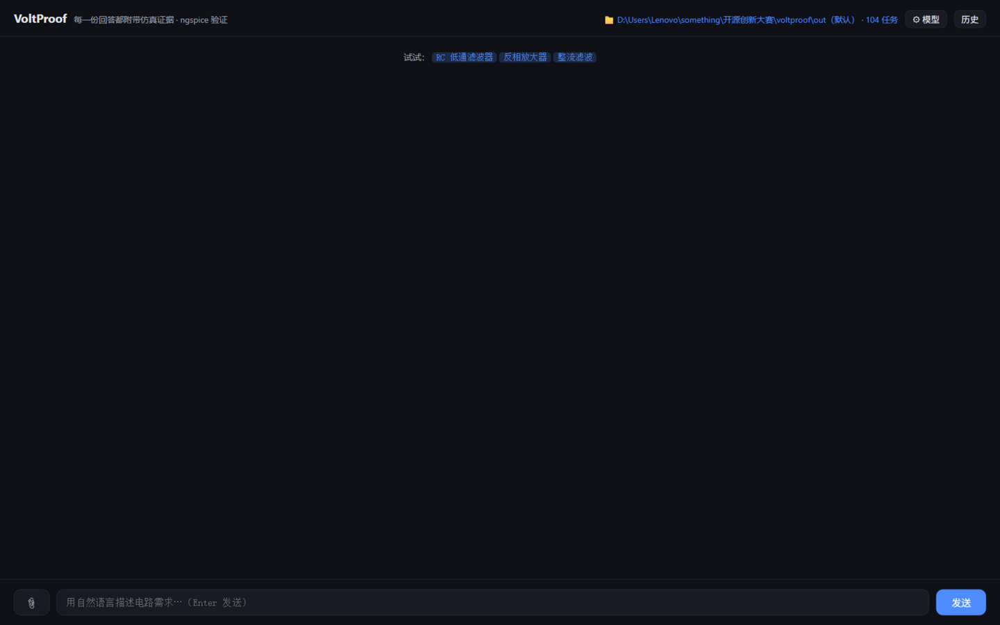
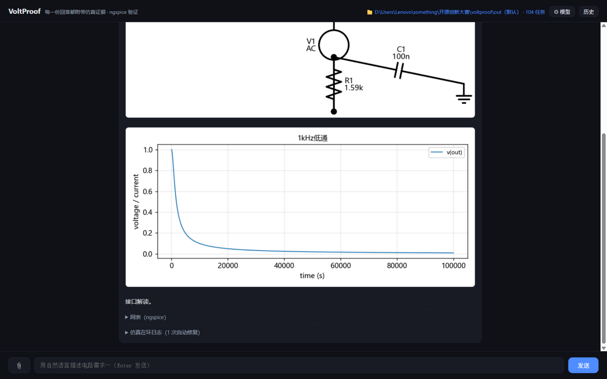
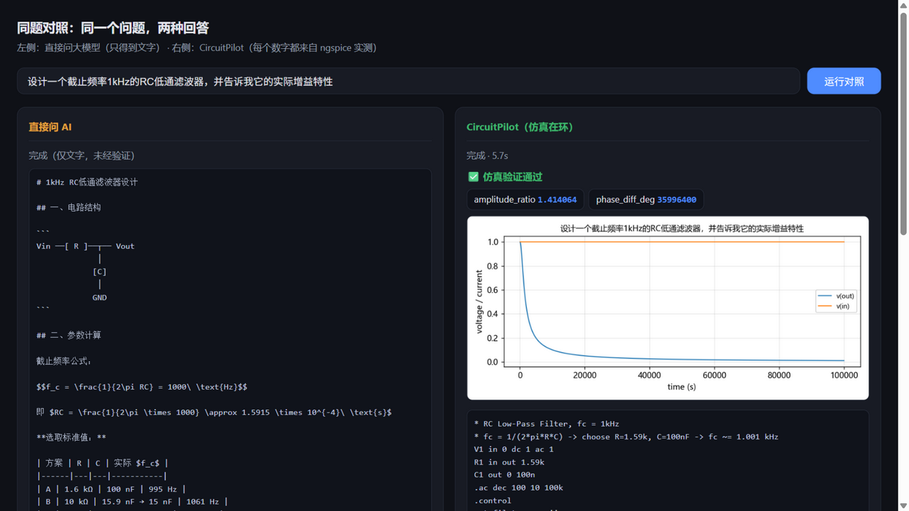

# VoltProof — 让 AI 的电路答案经过真实仿真验证

自然语言需求 → AI 生成 SPICE 网表 → **ngspice 真实仿真验证** → 波形 + 实测指标 + 原理图 + AI 解读。

> 直接问大模型，得到的是"关于电路的文字"；VoltProof 给出的是**被仿真验证过的电路**——
> 每一个数字都来自 ngspice 实测，指标不达标就自动带报错修复重试。

| 对话页 | 证据卡片（波形 + 指标 + 原理图 + 解读） | 同题对照页 |
|:---:|:---:|:---:|
|  |  |  |

## 特性

- **仿真在环**：AI 的每份回答都要先过 ngspice 仿真——不只判断"能仿真"，还实测纹波、截止频率、增益、主频等指标并与目标比对
- **自动修复循环**：静态检查或仿真失败时，报错与偏差被喂回 LLM 迭代修正，而不是把错误留给用户；修复过程经 `/chat/stream` 实时推送（前端逐轮可见"AI 被仿真器打回"）
- **证据可查**：波形图（AC 自动对数频率轴）、指标数值、原理图、完整网表随回答给出，每个结论可复核
- **交互式电路画板（人机协同）**：`/draw.html` 自己动手画——拖放元件、正交连线、网络标签，画完一键 ngspice 直仿（**零 LLM，无需配密钥**）；悬空引脚/缺地等接线错误在画布上直接标红。也可以在底部输入栏用自然语言让 **AI 画/改电路**：LLM 生成网表并经修复环真仿验证后，以高亮预览叠上画布，确认应用才替换（旧图可一键撤销）——AI 只出网表、几何由确定性算法布局，接线错误绝不带进画布
- **what-if 参数扫描**：对已验证电路改一个元件取多个值，逐点真实仿真出曲线族与指标趋势——纯确定性，非 AI 生成
- **实验报告导出**：一段对话一键导出单文件 HTML 报告（需求/网表/波形/指标表/结论），浏览器打印即 PDF
- **双轨后端**：LLM 直接写 SPICE 网表（默认），或写 [SKiDL](https://github.com/devbisme/skidl) Python 代码经沙箱构建
- **确定性原理图**：网表自动布局渲染，拓扑 100% 正确
- **多工作区（项目制）**：一个工作区 = 一个项目——**电路（画布 + 最后验证网表）是项目级资产**（`.cp/project.json`，随目录走、换电脑也在），项目下可开多条会话线程围绕同一电路讨论；所有线程、画板、what-if 共用这一份电路上下文；任务与产物按项目归档，拷走工作区目录即完整归档
- **模型自选**：任意 OpenAI 兼容供应商（DeepSeek / OpenAI / 本地 Ollama 等），页面 ⚙ 一键切换，密钥只存本机、永不回传
- **MCP Server**：`design_circuit` / `verify_netlist` 两个工具暴露给编程 agent（Claude Desktop / Cursor 等，见下文"作为 MCP 工具接入"）
- **同题对照**：`/compare.html` 并排演示同一个问题"直接问 AI"与"仿真验证后"的两种回答

## 快速开始

```bash
# 0. 环境：Python 3.10+；ngspice（SourceForge 下载解压即可）
setx VOLTPROOF_NGSPICE "C:\path\to\ngspice-47\Spice64\bin\ngspice.exe"   # Windows；已进 PATH 可跳过（setx 只对新开的终端生效）

# 1. 安装依赖
pip install -r requirements.txt

# 2. 配置模型（二选一）
#    a) 环境变量（也接受 DEEPSEEK_API_KEY / OPENAI_API_KEY）
setx VOLTPROOF_API_KEY 你的key
#    b) 启动后在页面右上角 ⚙ 模型 里填写（保存到本机 settings.json）

# 3. 离线自检（不需要 API Key，验证仿真链路/检查器/沙箱/接口契约/MCP 协议）
python tests/test_offline.py
python tests/test_pipeline_mock.py
python tests/test_bench_validators.py
python tests/test_mcp.py

# 4. 启动
uvicorn app.main:app --reload
# 浏览器打开 http://127.0.0.1:8000（对话页）
# 电路画板（无需配模型）：http://127.0.0.1:8000/draw.html
# 同题对照演示：http://127.0.0.1:8000/compare.html
# 也可 pip install . 后直接运行 voltproof 命令（自动挑端口并开浏览器）
```

## 使用指南

- **画电路**：对话页右上角「✏ 画电路」进入画板。左侧选元件点击画布放置（R 旋转、Del 删除），点元件引脚开始连线、点另一引脚/导线结束；接地符号决定节点 0，网络标签（in / out / vcc…）命名节点。选好分析类型（直流工作点 / 瞬态 / 交流扫描）点「仿真」——波形、实测指标、规范原理图随即可见，接线错误（悬空引脚、缺地）画布上直接标红。画布随项目保存在服务端（刷新/换电脑不丢），也可「导出 .cir」拿到网表。
- **AI 画 / 改电路**：画板底部输入栏用自然语言描述（空画布=画新电路，非空=在当前电路上改）。AI 生成的电路先高亮预览，点「✓ 应用」才替换画布、「✗ 丢弃」保留原图，「↶ 撤销AI」随时找回旧图。
- **项目 = 一份电路 + 多条线程**：画布与验证过的网表存在项目里（随工作区目录走），主页的每条会话线程都基于这份电路讨论与修改；画板右侧"会话轮次"是项目时间线（⚙手动仿真 / 🤖AI 画图 / 💬对话线程）；🔀 what-if 与实验报告直接作用于项目当前电路。旧版本按对话存电路的语义已升级——恢复旧对话只看历史记录，继续追问会基于项目当前电路。
- **对话**：直接用自然语言描述需求，例如"设计桥式整流+电容滤波电路，220V/50Hz 降压到 12V，纹波 <1V"。可附上网表或文本文件让 VoltProof 分析/改进。等待期间修复环逐轮实时可见。
- **证据卡片**：每份回答附判定（达标/未达标）、实测指标、波形图、原理图、AI 解读，以及完整网表——复核或搬到别处仿真都方便。
- **多轮迭代**：会话内继续提要求（"把纹波再压一半"），VoltProof 会携带上一轮验证过的网表继续改。
- **what-if 扫描**：对话区下方 🔀 按钮——选当前电路的一个元件（R/C/L/直流源）、给一组取值，VoltProof 逐值真实仿真，给出曲线族与指标表（增益/峰峰值/主频/-3dB 随参数的变化趋势）。
- **实验报告**：右上角"对话"历史面板里，每个会话有"📄 报告"入口——导出单文件 HTML（图片内嵌），浏览器打开后 Ctrl+P 即 PDF。
- **工作区**：顶栏可切换/查看当前工作区，"历史"面板列出全部历史任务与产物，拷走工作区目录即完整归档。
- **模型配置**：⚙ 弹层里可填供应商 Base URL / API Key / 模型名（可拉取供应商模型列表下拉选择）。本机 Ollama / LM Studio 需机主设置 `VOLTPROOF_ALLOW_PRIVATE_LLM=1` 豁免内网校验。
- **命令行**：`python -m app.pipeline "设计一个截止频率1kHz的RC低通滤波器"` 直接跑完整管道。

## 作为 MCP 工具接入（Claude Desktop / Cursor 等）

VoltProof 自带 stdio MCP Server，把仿真在环管线暴露为两个工具：`design_circuit`（自然语言设计并验证）与 `verify_netlist`（验证/修复外部网表）。客户端配置：

```json
{
  "mcpServers": {
    "voltproof": {
      "command": "python",
      "args": ["-m", "app.mcp_server"],
      "cwd": "<VoltProof 仓库或便携包根目录>"
    }
  }
}
```

pip 安装用户可用 `"command": "voltproof-mcp"`。API Key 仍走环境变量 / settings.json，与网页版共用。

## 环境变量

| 变量 | 必填 | 说明 |
|---|---|---|
| `VOLTPROOF_API_KEY` | 是* | OpenAI 兼容 API Key（*也可在前端 ⚙ 里配置；另接受 `DEEPSEEK_API_KEY` / `OPENAI_API_KEY`） |
| `VOLTPROOF_BASE_URL` | 否 | 默认 `https://api.deepseek.com`，任意 OpenAI 兼容网关 |
| `VOLTPROOF_MODEL` | 否 | 默认 `deepseek-flash` |
| `VOLTPROOF_NGSPICE` | 视环境 | ngspice 可执行文件完整路径；已在 PATH 中可省略 |
| `VOLTPROOF_SETTINGS` | 否 | settings.json 路径（默认仓库根目录） |
| `VOLTPROOF_LLM_TIMEOUT` | 否 | 单次 LLM 调用超时秒数，默认 480（推理型模型长思考需要） |
| `VOLTPROOF_LLM_RETRIES` | 否 | SDK 对超时/断连/429/5xx 的自动重试次数，默认 2 |
| `VOLTPROOF_THINKING` | 否 | 思考模式总开关 on/off，默认 on |
| `VOLTPROOF_REASONING_EFFORT` | 否 | none/low/high/max，默认不传 |
| `VOLTPROOF_SIM_TIMEOUT` | 否 | 单次仿真超时秒数，默认 30 |
| `VOLTPROOF_CACHE` | 否 | 结果缓存开关，默认开（`0` 关闭） |
| `VOLTPROOF_DOT` | 否 | graphviz dot.exe 路径（不可用时回退网格布局） |
| `VOLTPROOF_WORKSPACE` | 否 | 启动时绑定工作区目录（缺省用仓库 `out/`，运行中可经页面切换） |
| `VOLTPROOF_ALLOW_PRIVATE_LLM` | 否 | 豁免供应商地址的内网/环回校验（本机 Ollama 等用），默认 off |

## 基准测试

```bash
python bench/run_bench.py                     # 18 个典型电路任务（spice 后端）
python bench/run_bench.py --passes=3          # 每任务独立跑 3 次：pass@1 / pass@3 统计
python bench/run_bench.py --backend=skidl     # SKiDL 后端
```

任务覆盖 RC/LC 滤波、高低通、整流滤波、反相/同相/差动/求和放大、共射放大、跟随器、限幅、稳压、张弛振荡、传感器调理等分立元件典型电路，验收为指标级——纹波上限、截止频率、增益、振荡频率等逐项与理论值比对。LLM 输出有非确定性，`--passes` 的 pass@k 才是可比口径。

最近一次实测（DeepSeek deepseek-flash，18 任务 × 3 次独立运行）：**pass@1 = 92.6%，pass@3 = 100%**。唯一低稳定任务为张弛振荡器（square-osc）——经振荡器专项加固（禁手写 555 行为模型改用运放张弛结构、起振 .ic 双电容覆盖、断行表达式误报修复）后单任务 3/4，其余任务 ≥2/3。

## 安全说明

VoltProof 按**本地单机工具**设计，请绑定 127.0.0.1 使用：网表与 LLM 生成代码均经安全过滤与受限沙箱执行，供应商地址做 SSRF 校验。请勿在未加鉴权与隔离的情况下将其暴露到公网。

## 许可证

[Apache-2.0](LICENSE)
