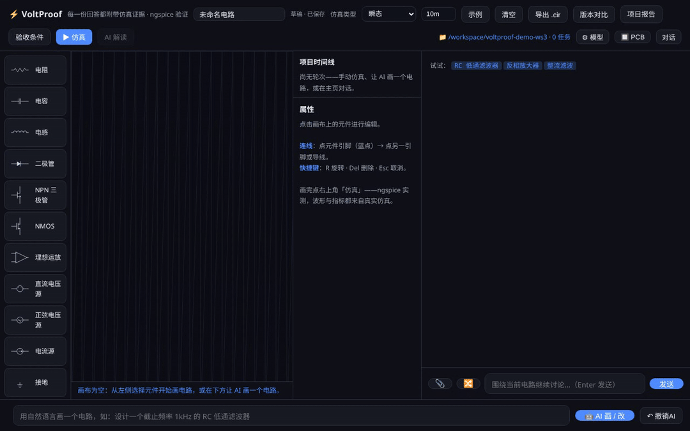

<div align="center">

# VoltProof

用真实的 ngspice 仿真，验证 AI 给出的电路答案。

[English](README.md) · [简体中文](README.zh-CN.md)

[](https://github.com/Kevin-Y572/VoltProof)
[](https://www.python.org/)
[](LICENSE)



</div>

VoltProof 是一个本地工作台，用真实的 [ngspice](https://ngspice.sourceforge.io/) 仿真来检查 AI 给出的电路。你可以用自然语言描述电路，也可以在画布上画。VoltProof 会写出 SPICE 网表，跑一遍 ngspice，并给出波形、测得的数据和原理图。如果结果没达到目标，它可以把误差送回模型再试一次。

## 特性

- 把 AI 的每份回答都交给 ngspice 运行，并查看波形和测得的数据
- 检查或仿真失败时，可以把误差送回模型再试一次
- 无需密钥即可在画布上画图并仿真，也可以在对话里用自然语言描述电路
- 对某个元件取一组值，逐点重新仿真
- 导出独立的 HTML 实验报告，并可打印为 PDF
- 支持任何 OpenAI 兼容的服务，包括本机 Ollama；密钥只保存在你的电脑上

## 安装

VoltProof 在 Linux 和 Windows 上都可以用。需要 Python 3.10 或更高版本，以及 [ngspice](https://ngspice.sourceforge.io/)。请把 ngspice 加入 `PATH`，或用 `VOLTPROOF_NGSPICE` 指向可执行文件（Linux 多为 `/usr/bin/ngspice`，Windows 多为 `ngspice.exe`）。

### Linux

在 Debian / Ubuntu 上从源码启动：

```bash
sudo apt update
sudo apt install -y python3 python3-venv python3-pip ngspice
python3 -m venv .venv
source .venv/bin/activate
pip install -r requirements.txt
uvicorn app.main:app --host 127.0.0.1 --port 8000
```

也可以构建 `.deb`。包里有 VoltProof、Python 依赖、`voltproof` 命令和桌面入口。ngspice 是包依赖，由系统安装。KiCad、Java 和 Freerouting 不打进包里。

```bash
python3 scripts/build_linux_deb.py
sudo apt install ./dist/voltproof_*.deb
voltproof
```

请在要安装的那台机器上构建，并使用相同的 Python 次版本。构建脚本是 `scripts/build_linux_deb.py`，可以重复运行。数据在 `~/.local/share/voltproof`，模型设置在 `~/.config/voltproof/settings.json`。打包和 PCB 的逐步说明见 [docs/LINUX.md](docs/LINUX.md)。

### Windows

```bash
pip install -r requirements.txt
uvicorn app.main:app --host 127.0.0.1 --port 8000
```

Windows 便携 zip 是另一条构建：`python scripts/build_portable.py`。

打开 [http://127.0.0.1:8000](http://127.0.0.1:8000)，点「示例」，再点「仿真」，就能看到一个 RC 低通的真实波形。这一步不用配置模型密钥。

工作台默认是简体中文。顶栏的「中文 / English」可以切换界面语言，选择会被记住。

也可以先执行 `pip install .`，再运行 `voltproof`。Linux 的 `.deb` 提供同一个命令。

| 页面 | 地址 |
| --- | --- |
| 工作台（画布 + 对话） | http://127.0.0.1:8000 |
| 独立画板 | http://127.0.0.1:8000/draw.html |
| 同题对照 | http://127.0.0.1:8000/compare.html |

## 使用方法

**画图并仿真。** 在左侧画布上放置元件、连线，选择直流、瞬态或交流分析，然后点「仿真」。悬空引脚和缺少接地会在画布上标出。你可以导出 `.cir` 网表。电路会随项目保存。

**让模型来设计。** 在对话里直接说明需求，例如：「设计桥式整流加电容滤波电路，220 V / 50 Hz 降压到 12 V，纹波小于 1 V。」后续追问会基于上一份已验证的网表继续改。也可以在画布下方的输入栏里提出修改，结果会先预览，确认后才应用。

只有使用 AI 设计时才需要模型密钥。设置 `VOLTPROOF_API_KEY`（或 `DEEPSEEK_API_KEY` / `OPENAI_API_KEY`），也可以在页面的模型设置里填写。

**参数扫描。** 对某个元件取一组值，逐点做真实仿真。

**实验报告。** 可以把一次对话导出为独立的 HTML 报告，再打印成 PDF。

## MCP

VoltProof 自带 stdio MCP 服务，提供两个工具：`design_circuit`（设计并验证）和 `verify_netlist`（按原样验证网表；若设置 `repair=true` 则允许修复）。

```json
{
  "mcpServers": {
    "voltproof": {
      "command": "python",
      "args": ["-m", "app.mcp_server"],
      "cwd": "<VoltProof 仓库根目录>"
    }
  }
}
```

如果是用 pip 安装的，可以把 `"command"` 写成 `"voltproof-mcp"`。

## PCB 导出（实验性）

工作台、画板、对照页和 ngspice 仿真都不依赖这一节。装上下表里的工具之后，Linux 和 Windows 都会跑完整条制板链：预检、映射、KiCad 造板、Freerouting、SES 回导与铺铜、DRC 与连通性，然后是 Gerber、钻孔和 BOM。缺工具时，「生成 PCB」保持禁用，任务会在布线之前失败，并给出安装提示。

这一节仍然是实验功能。可选的布局代理只能根据已验证电路提出封装坐标；布线或 DRC 失败后，也只能做有界修改。合法化器会检查每一份提案，铜还是 Freerouting 布的。模型不输出走线，也不写 `.kicad_pcb`，跑完不等于可以投产。模型没开、不可用或提案被拒绝时，仍用原来的信号流布局。理想运放不能直接上板：「换成 LM358 候选」会补供电脚、重新仿真，并保存一个新的项目候选，不改当前采用的电路。说明和无工具检查（`scripts/pcb_smoke.py --agent-offline`）在 [docs/LINUX.md](docs/LINUX.md)。

| 工具 | 要求 | 安装方式 |
| --- | --- | --- |
| KiCad | 10.x。当前稳定线是 `ppa:kicad/kicad-10.0-releases` 里的 10.0.8。 | Linux：`kicad` 与 `kicad-footprints`（`/usr/bin/kicad-cli`，`/usr/bin/python3` 能导入 pcbnew，封装在 `/usr/share/kicad/footprints`）。Windows：安装器，或把 `VOLTPROOF_KICAD` 指到含 `bin/kicad-cli.exe` 与 `bin/python.exe` 的根目录。 |
| Java | 21 或更高 | Linux：`openjdk-21-jre-headless`。`VOLTPROOF_JAVA` 可以指向 `java` 可执行文件。 |
| Freerouting | JVM JAR `freerouting-2.1.0.jar` | 放到 `/opt/freerouting/`，或设 `VOLTPROOF_FREEROUTING` 为 jar 路径。 |

不要用 Freerouting 2.5.0 的原生可执行文件，它会崩溃并挂死。2.2 及之后的 JAR 按 Java 25 构建。`freerouting-2.1.0.jar` 是能在 Java 21 上跑的 JVM JAR。

Flatpak 版 KiCad 不会被自动发现。请装发行版或 PPA 包，或把 `VOLTPROOF_KICAD` 指到含 `bin/kicad-cli`、且其 Python 能 `import pcbnew` 的前缀。

Debian/Ubuntu 上可直接复制的安装命令，以及做一次真实制板回归前要跑的检查，写在 [docs/LINUX.md](docs/LINUX.md)。

## 补充说明

如果 ngspice 还不在 `PATH` 里：

```bash
# Windows（setx 只对之后新开的终端生效）
setx VOLTPROOF_NGSPICE "C:\path\to\ngspice-47\Spice64\bin\ngspice.exe"

# macOS / Linux
export VOLTPROOF_NGSPICE=/usr/bin/ngspice
```

命令行用法：

```bash
python -m app.pipeline "设计一个截止频率 1 kHz 的 RC 低通滤波器"
```

VoltProof 按本地单用户工具来设计，请绑定 `127.0.0.1`。不要在未加鉴权和隔离的情况下把它暴露到公网。

网表和模型生成的 Python 会先做检查：拒绝危险的 `.control` 命令、解析后离开仿真目录的 include 路径，以及 Python 的 dunder 属性访问。ngspice 以 `-n`（`--no-spiceinit`）启动，环境里不带 API 密钥。这些检查不是操作系统级沙箱。

## 许可证

[Apache-2.0](LICENSE)
