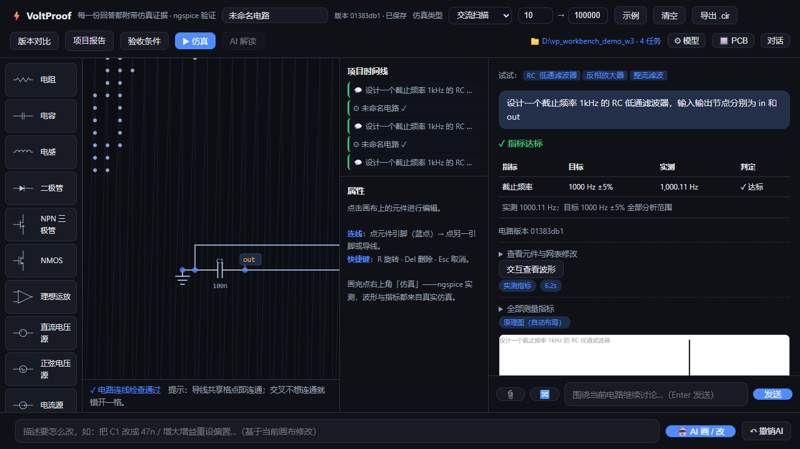
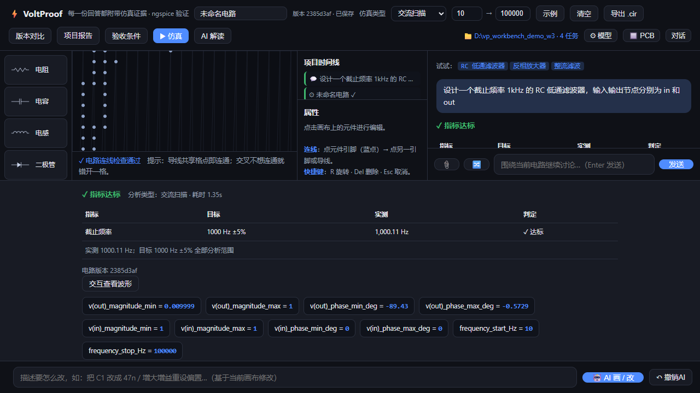
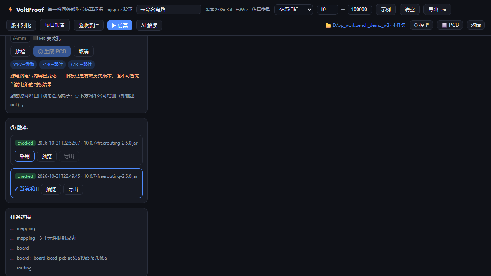

# VoltProof — 让 AI 的电路答案经过真实仿真验证

[English](README.md) · [简体中文](README.zh-CN.md)

自然语言需求 → AI 生成 SPICE 网表 → **ngspice 真实仿真验证** → 波形 + 实测指标 + 原理图 + AI 解读。

> 直接问大模型，得到的是"关于电路的文字"；VoltProof 给出的是**被仿真验证过的电路**——
> 每一个数字都来自 ngspice 实测，指标不达标就自动带报错修复重试。

当前版本将需求验收、草稿与电路版本统一接入工作台。性能指标来自仿真数据，元件参数按网表检查；“指标达标”“仿真完成但未设目标”“验证不完整”分别展示。详见 [产品完善记录](docs/PRODUCT_UPDATE.md) 和 [RC 实验试用方案](docs/TEACHING_PILOT.md)。

| 一体化工作台（画布 + 对话同屏） | 证据卡（验收表 + 电路版本） | PCB 导出预览（实验性） |
|:---:|:---:|:---:|
|  |  |  |

## 特性

- **明确验收**：识别常见截止频率、增益、纹波、输出电压和元件修改；顶部“验收条件”可指定目标、比较方式、容差及节点。普通对话、画布、MCP、扫描与声明式基准共用验收器；不能测量的项目标为未验证。截止频率设计采用固定扫频窗口与节点输出。
- **版本与候选**：AI 画图先保留候选，应用后才切换项目；丢弃不改变电路，撤销恢复网表、画布、分析和证据。画布修改后需重新验证；迟到任务不能覆盖新编辑。
- **操作意图**：解释读取当前证据，只验证保持元件与连接，修改附件进入修改流程，诊断生成候选；“和上一个版本比较”读取历史结果。
- **交互波形与对比**：节点选择、区间查看、游标读数与 AC 相位；版本对比展示已保存指标和网表差异，并提示核对各自工况。

- **仿真在环**：AI 的每份回答都要先过 ngspice 仿真——不只判断"能仿真"，还实测纹波、截止频率、增益、主频等指标并与目标比对
- **自动修复循环**：静态检查或仿真失败时，报错与偏差被喂回 LLM 迭代修正，而不是把错误留给用户；修复过程经 `/chat/stream` 实时推送（前端逐轮可见"AI 被仿真器打回"）
- **证据可查**：波形图（AC 自动对数频率轴）、指标数值、原理图、完整网表随回答给出，每个结论可复核
- **一体化工作台（画布 + 对话同屏）**：主页 `/` 左侧是交互式电路画板、右侧是对话线程，共用项目里的同一份电路——拖放元件、正交连线、网络标签，画完一键 ngspice 直仿（**零 LLM，无需配密钥**）；悬空引脚/缺地等接线错误在画布上直接标红。也可以在底部输入栏用自然语言让 **AI 画/改电路**：LLM 生成网表并经修复环真仿验证后，以高亮预览叠上画布，确认应用才替换（旧图可一键撤销）——AI 只出网表、几何由确定性算法布局，接线错误绝不带进画布。在右侧对话里改电路，验证通过后新电路会自动落布回左侧画布。窄窗口自动切换为「画布 / 对话」页签；独立画板页 `/draw.html` 仍然可用
- **what-if 参数扫描**：对已验证电路改一个元件取多个值，逐点真实仿真出曲线族与指标趋势——纯确定性，非 AI 生成
- **实验报告导出**：一段对话一键导出单文件 HTML 报告（需求/网表/波形/指标表/结论），浏览器打印即 PDF
- **双轨后端**：LLM 直接写 SPICE 网表（默认），或写 [SKiDL](https://github.com/devbisme/skidl) Python 代码经沙箱构建
- **确定性原理图**：网表自动布局渲染，拓扑 100% 正确
- **多工作区（项目制）**：一个工作区 = 一个项目——**电路（画布 + 最后验证网表）是项目级资产**（`.cp/project.json`，随目录走、换电脑也在），项目下可开多条会话线程围绕同一电路讨论；所有线程、画板、what-if 共用这一份电路上下文；任务与产物按项目归档，拷走工作区目录即完整归档
- **模型自选**：任意 OpenAI 兼容供应商（DeepSeek / OpenAI / 本地 Ollama 等），页面 ⚙ 一键切换，密钥只存本机、永不回传
- **MCP Server**：`design_circuit` / `verify_netlist` 两个工具暴露给编程 agent（Claude Desktop / Cursor 等，见下文"作为 MCP 工具接入"）
- **同题对照**：`/compare.html` 并排演示同一个问题"直接问 AI"与"仿真验证后"的两种回答

## 快速开始

```bash
# 0. 环境：Python 3.10+；ngspice（SourceForge 下载解压即可）
setx VOLTPROOF_NGSPICE "C:\path\to\ngspice-47\Spice64\bin\ngspice.exe"   # Windows；已进 PATH 可跳过（setx 只对新开的终端生效）

# 1. 安装依赖
pip install -r requirements.txt

# 2. 配置模型（二选一）
#    a) 环境变量（也接受 DEEPSEEK_API_KEY / OPENAI_API_KEY）
setx VOLTPROOF_API_KEY 你的key
#    b) 启动后在页面右上角 ⚙ 模型 里填写（保存到本机 settings.json）

# 3. 离线自检（不需要 API Key，验证仿真链路/检查器/沙箱/接口契约/MCP 协议）
python scripts/test_isolated.py
# 临时副本中运行五套测试，日志保存在 .test-results/
# 单套：python scripts/test_isolated.py test_product.py

# 4. 启动
uvicorn app.main:app --reload
# 浏览器打开 http://127.0.0.1:8000（一体化工作台：左画布右对话）
# 独立画板页（无需配模型）：http://127.0.0.1:8000/draw.html
# 同题对照演示：http://127.0.0.1:8000/compare.html
# 也可 pip install . 后直接运行 voltproof 命令（自动挑端口并开浏览器）
```

## 使用指南

- **画电路**：主页左栏（或独立页 `/draw.html`）就是画板。左侧选元件点击画布放置（R 旋转、Del 删除），点元件引脚开始连线、点另一引脚/导线结束；接地符号决定节点 0，网络标签（in / out / vcc…）命名节点。选好分析类型（直流工作点 / 瞬态 / 交流扫描）点「仿真」——波形、实测指标、规范原理图随即可见，接线错误（悬空引脚、缺地）画布上直接标红。画布随项目保存在服务端（刷新/换电脑不丢），也可「导出 .cir」拿到网表。
- **AI 画 / 改电路**：画板底部输入栏用自然语言描述（空画布=画新电路，非空=在当前电路上改）。AI 生成的电路先高亮预览，点「✓ 应用」才替换画布、「✗ 丢弃」保留原图，「↶ 撤销AI」随时找回旧图。
- **项目 = 一份电路 + 多条线程**：画布与验证过的网表存在项目里（随工作区目录走），主页右栏的每条会话线程都基于这份电路讨论与修改——对话里验证通过的新电路会自动落布回左栏画布（图形转换失败时清空旧图并保留完整网表）；画板右栏"项目时间线"汇总全部轮次（⚙手动仿真 / 🤖AI 画图 / 💬对话线程）；🔀 what-if 与实验报告直接作用于项目当前电路。旧版本按对话存电路的语义已升级——恢复旧对话只看历史记录，继续追问会基于项目当前电路。
- **对话**：直接用自然语言描述需求，例如"设计桥式整流+电容滤波电路，220V/50Hz 降压到 12V，纹波 <1V"。可附上网表或文本文件让 VoltProof 分析/改进。等待期间修复环逐轮实时可见。
- **证据卡片**：每份回答附判定（达标/未达标）、实测指标、波形图、原理图、AI 解读，以及完整网表——复核或搬到别处仿真都方便。
- **多轮迭代**：会话内继续提要求（"把纹波再压一半"），VoltProof 会携带上一轮验证过的网表继续改。
- **what-if 扫描**：对话区下方 🔀 按钮——选当前电路的一个元件（R/C/L/直流源）、给一组取值，VoltProof 逐值真实仿真，给出曲线族、指标与目标验收结果；合格点可“采用这个值”为新版本，每点网表和 raw 独立归档。
- **实验报告**：顶部“项目报告”汇总当前版本、各入口运行与扫描；右上角"对话"历史面板里，每个会话有"📄 报告"入口——导出单文件 HTML（图片内嵌），浏览器打开后 Ctrl+P 即 PDF。
- **工作区**：顶栏可切换/查看当前工作区，"历史"面板列出全部历史任务与产物，拷走工作区目录即完整归档。
- **模型配置**：⚙ 弹层里可填供应商 Base URL / API Key / 模型名（可拉取供应商模型列表下拉选择）。本机 Ollama / LM Studio 需机主设置 `VOLTPROOF_ALLOW_PRIVATE_LLM=1` 豁免内网校验。
- **命令行**：`python -m app.pipeline "设计一个截止频率1kHz的RC低通滤波器"` 直接跑完整管道。

## PCB 导出（实验性，可选工具链）

已验证的电路可以走 **网表 → 器件映射 → 自动布线 → DRC → 制板文件** 流水线（RC/分压/整流等分立元件电路；理想运放等会明确提示需先替换为具体型号）：

```bash
# 可选外部工具：KiCad 10.x 与 Freerouting（JVM JAR 版）
setx VOLTPROOF_KICAD "C:\Program Files\KiCad\10.0.7"     # bin/ 下须有 kicad-cli.exe 与 python.exe
setx VOLTPROOF_FREEROUTING "D:\tools\freerouting-2.5.0.jar"

python scripts/pcb_smoke.py   # 全链自检：造板→DSN→布线→DRC→Gerber，档案落 pcb/runs/
```

HTTP 接口：`GET /api/pcb/capabilities`（工具探测）、`POST /api/pcb/preflight`（网表预检：角色/阻断项/端口候选）、`POST /api/pcb/jobs`（提交任务，轮询 `GET /api/pcb/jobs/{id}`；布线结果经网络分区对照 + KiCad DRC 双重复核）、`GET /api/pcb/versions`、`POST /api/pcb/apply`（采用候选版本，带 revision 冲突保护）、`POST /api/pcb/export`（冻结制板包）。工具缺失时这些端点返回修复指引，不影响仿真主功能。详见 `docs/PCB_PHASE_A.md` / `PCB_PHASE_B.md`。

## 作为 MCP 工具接入（Claude Desktop / Cursor 等）

VoltProof 自带 stdio MCP Server：`design_circuit` 设计并验证；`verify_netlist` 默认零 LLM 原样验证，`repair=true` 时才允许修复。两项工具均接受 `requirements`，返回文本与 `structuredContent`，失败设置 `isError`。客户端配置：

```json
{
  "mcpServers": {
    "voltproof": {
      "command": "python",
      "args": ["-m", "app.mcp_server"],
      "cwd": "<VoltProof 仓库或便携包根目录>"
    }
  }
}
```

pip 安装用户可用 `"command": "voltproof-mcp"`。API Key 仍走环境变量 / settings.json，与网页版共用。

结构化验收示例（目标使用基本单位，`tol` 为相对误差）：

```json
{"request":"设计RC低通滤波器", "requirements":[
  {"metric":"fc", "target":1000, "op":"near", "tol":0.05, "out":"out", "in":"in", "filter_type":"lowpass"}
]}
```

自动语言识别覆盖常见明确表达；复杂条件应通过验收编辑器明确指定。当前截止频率支持一阶低通/高通，功耗、阻抗等专用指标不会默认判定达标。

## 环境变量

| 变量 | 必填 | 说明 |
|---|---|---|
| `VOLTPROOF_API_KEY` | 是* | OpenAI 兼容 API Key（*也可在前端 ⚙ 里配置；另接受 `DEEPSEEK_API_KEY` / `OPENAI_API_KEY`） |
| `VOLTPROOF_BASE_URL` | 否 | 默认 `https://api.deepseek.com`，任意 OpenAI 兼容网关 |
| `VOLTPROOF_MODEL` | 否 | 默认 `deepseek-flash` |
| `VOLTPROOF_NGSPICE` | 视环境 | ngspice 可执行文件完整路径；已在 PATH 中可省略 |
| `VOLTPROOF_SETTINGS` | 否 | settings.json 路径（默认仓库根目录） |
| `VOLTPROOF_LLM_TIMEOUT` | 否 | 单次 LLM 调用超时秒数，默认 480（推理型模型长思考需要） |
| `VOLTPROOF_LLM_RETRIES` | 否 | SDK 对超时/断连/429/5xx 的自动重试次数，默认 2 |
| `VOLTPROOF_THINKING` | 否 | 思考模式总开关 on/off，默认 on |
| `VOLTPROOF_REASONING_EFFORT` | 否 | none/low/high/max，默认不传 |
| `VOLTPROOF_SIM_TIMEOUT` | 否 | 单次仿真超时秒数，默认 30 |
| `VOLTPROOF_CACHE` | 否 | 结果缓存开关，默认开（`0` 关闭） |
| `VOLTPROOF_DOT` | 否 | graphviz dot.exe 路径（不可用时回退网格布局） |
| `VOLTPROOF_WORKSPACE` | 否 | 启动时绑定工作区目录（缺省用仓库 `out/`，运行中可经页面切换） |
| `VOLTPROOF_ALLOW_PRIVATE_LLM` | 否 | 豁免供应商地址的内网/环回校验（本机 Ollama 等用），默认 off |

## 基准测试

```bash
python bench/run_bench.py                     # 18 个典型电路任务（spice 后端）
python bench/run_bench.py --passes=3          # 每任务独立跑 3 次：pass@1 / pass@3 统计
python bench/run_bench.py --backend=skidl     # SKiDL 后端
```

任务覆盖 RC/LC 滤波、高低通、整流滤波、反相/同相/差动/求和放大、共射放大、跟随器、限幅、稳压、张弛振荡、传感器调理等分立元件典型电路，验收为指标级——纹波上限、截止频率、增益、振荡频率等逐项与理论值比对。LLM 输出有非确定性，`--passes` 的 pass@k 才是可比口径。

最近一次实测（DeepSeek deepseek-flash，18 任务 × 3 次独立运行，2026-10-31，本版管线）：初次生成通过率 **61.1%**（不含修复，体现修复环价值）→ 闭环 **pass@1 = 94.4%，pass@3 = 100%**，平均 40.4s/任务。完整 JSON、报告与工作区存入不覆盖的 `bench/runs/<run_id>/`；pass@1 指一次完整闭环任务成功率，内部最多修复 3 轮。

## 安全说明

VoltProof 按**本地单机工具**设计，请绑定 127.0.0.1 使用：网表与 LLM 生成代码均经安全过滤与受限沙箱执行，供应商地址做 SSRF 校验。请勿在未加鉴权与隔离的情况下将其暴露到公网。

## 许可证

[Apache-2.0](LICENSE)
